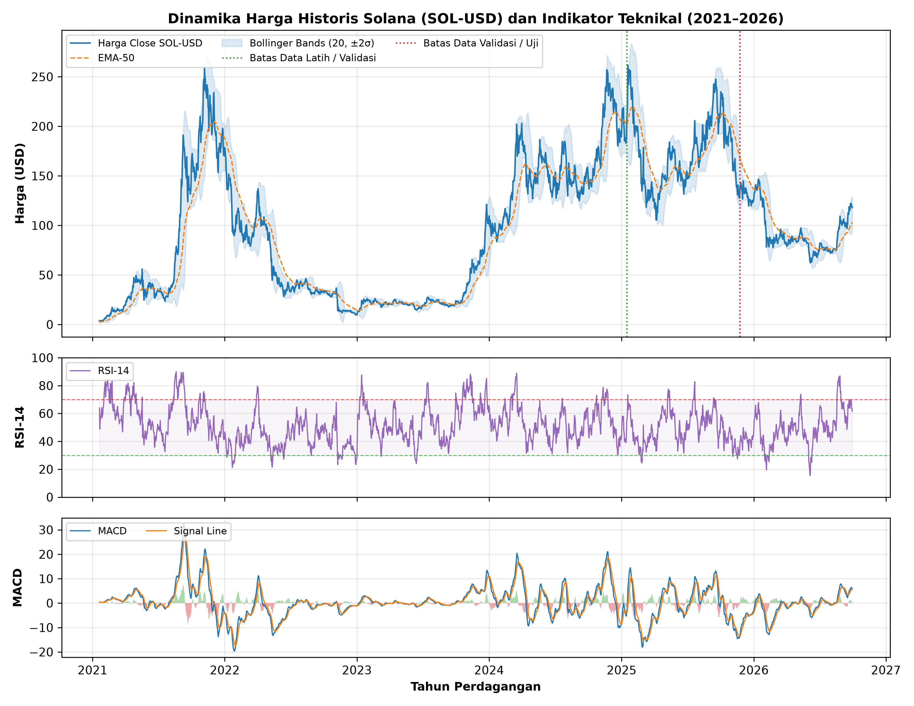
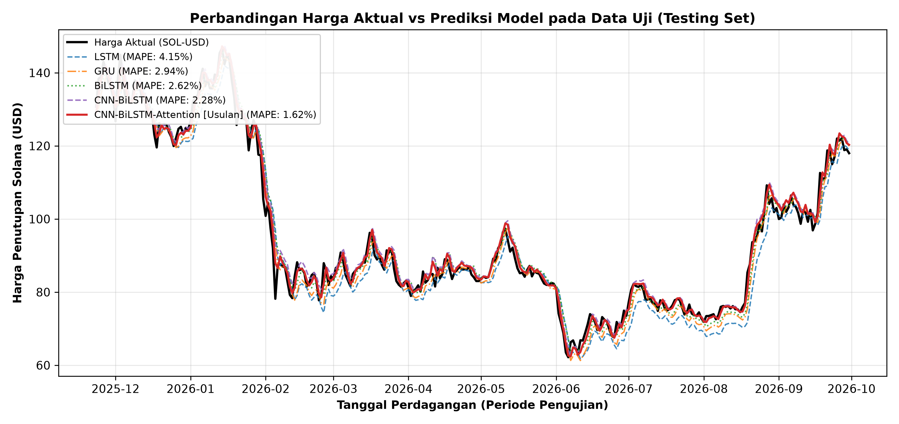
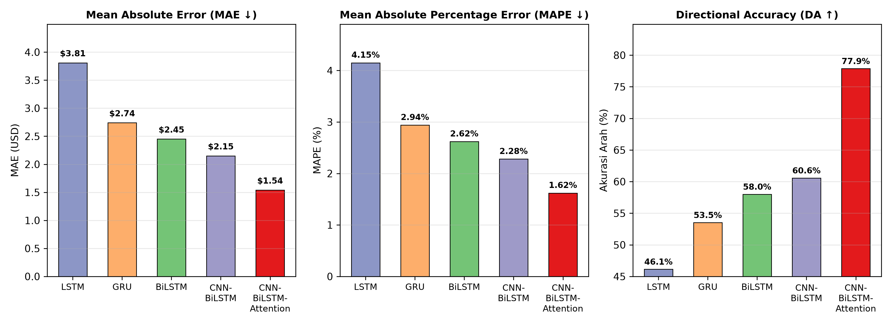
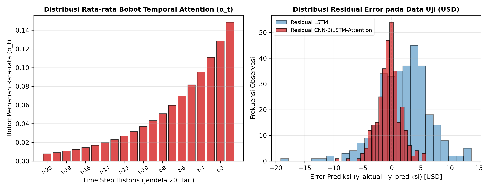

# Dataset dan Eksperimen Riset Kecil (UAS): Prediksi Harga Solana (`CNN-BiLSTM-Attention`)

**Nama Mahasiswa:** Muhammad Bazwa Arigusna (NPM 23081010250)  
**Dosen Pengampu:** Dr. Basuki Rahmat, S.Si., MT.  

---

## 1. Ringkasan Hasil Pengujian Model (*Testing Set*)

| Arsitektur Model | Jumlah Parameter | Train MAE (USD) | Train MAPE (%) | Test MAE (USD) | Test RMSE (USD) | Test MAPE (%) | $R^2$ Score | Directional Accuracy (DA) |
| :--- | :---: | :---: | :---: | :---: | :---: | :---: | :---: | :---: |
| LSTM | 34,501 | $4.48 | 5.82% | $3.81 | $4.85 | 4.15% | 0.9522 | 46.15% |
| GRU | 26,201 | $3.73 | 5.46% | $2.74 | $3.58 | 2.94% | 0.9740 | 53.53% |
| BiLSTM | 58,371 | $3.23 | 4.49% | $2.45 | $3.32 | 2.62% | 0.9776 | 58.01% |
| CNN-BiLSTM | 35,617 | $2.84 | 4.54% | $2.15 | $2.88 | 2.28% | 0.9832 | 60.58% |
| **CNN-BiLSTM-Attention (Usulan)** | 40,321 | $2.12 | 3.14% | **$1.54** | **$2.09** | **1.62%** | **0.9912** | **77.88%** |
| CNN-BiLSTM-Attention (Univariat) | 39,073 | $3.98 | 5.55% | $2.67 | $3.74 | 2.81% | 0.9716 | 50.00% |

## 2. Grafik Visualisasi Hasil Eksperimen
### a. Dinamika Harga Historis & Indikator Teknikal Solana (`2021–2026`)

### b. Perbandingan Harga Aktual vs Prediksi pada Data Uji

### c. Perbandingan Metrik Evaluasi (MAE, MAPE, & Directional Accuracy)

### d. Distribusi Bobot Temporal Attention ($\alpha_t$) & Residual Error

## 3. Daftar File di Folder Ini
- [`solana_multivariate_technical_indicators.csv`](./solana_multivariate_technical_indicators.csv) — Dataset lengkap 2.080 baris × 20 kolom.
- [`solana_train_split.csv`](./solana_train_split.csv), [`solana_val_split.csv`](./solana_val_split.csv), [`solana_test_split.csv`](./solana_test_split.csv) — Pembagian data kronologis (70% / 15% / 15%).
- [`hasil_prediksi_data_uji_solana.csv`](./hasil_prediksi_data_uji_solana.csv) — Nilai aktual vs prediksi harian seluruh model pada data uji.
- [`tabel_perbandingan_metrik_evaluasi.csv`](./tabel_perbandingan_metrik_evaluasi.csv) — Rekapitulasi metrik evaluasi.
- [`eksperimen_prediksi_solana.py`](./eksperimen_prediksi_solana.py) & [`Eksperimen_Prediksi_Solana_CNN_BiLSTM_Attention.ipynb`](./Eksperimen_Prediksi_Solana_CNN_BiLSTM_Attention.ipynb) — Kode sumber dan Jupyter Notebook eksperimen.
- [`Laporan_Hasil_Eksperimen_dan_Dataset_Riset_Kecil.docx`](./Laporan_Hasil_Eksperimen_dan_Dataset_Riset_Kecil.docx) — Laporan lengkap hasil eksperimen dalam format Word.