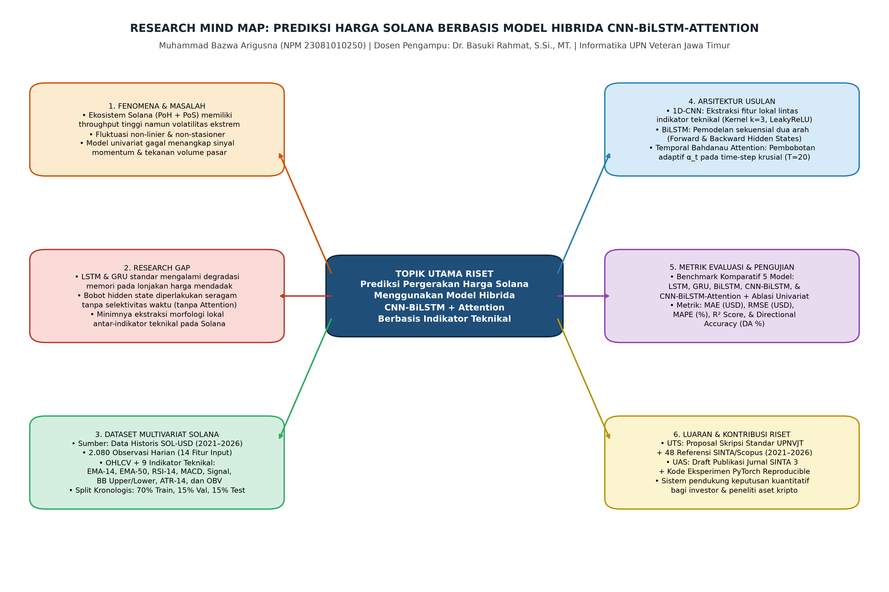
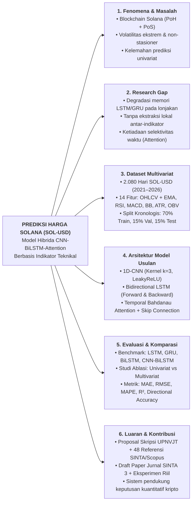

# Research Mind Map: Prediksi Harga Solana (CNN-BiLSTM-Attention)

**Nama Mahasiswa:** Muhammad Bazwa Arigusna (NPM 23081010250)  
**Dosen Pengampu:** Dr. Basuki Rahmat, S.Si., MT.  

---

## 1. Diagram Visual Mind Map (High-Resolution)

## 2. Diagram Alir Mermaid

## 3. Daftar File di Folder Ini
- [`research_mind_map_solana.png`](./research_mind_map_solana.png) — Gambar Mind Map resolusi tinggi (300 DPI).
- [`research_mind_map_solana.svg`](./research_mind_map_solana.svg) — Grafik vektor Mind Map (SVG).
- [`research_mind_map.mmd`](./research_mind_map.mmd) — Kode sumber diagram Mermaid.
- [`Penjelasan_Research_Mind_Map_Solana.docx`](./Penjelasan_Research_Mind_Map_Solana.docx) — Dokumen uraian lengkap keenam cabang *Research Mind Map*.
